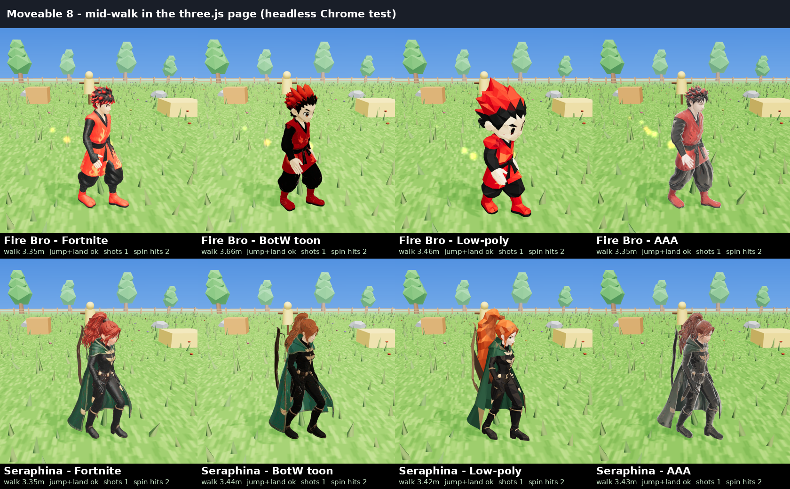

# Moveable 8 🔥🏹

Fire Bro ×4 styles + Seraphina ×4 styles, rigged and animated, playable in a phone browser (three.js).

**Play:** https://nasoteisoy.github.io/moveable-8/

| Page | What |
|---|---|
| [index.html](https://nasoteisoy.github.io/moveable-8/) | Fast: all 8, models load from `glb/` |
| [play_fire_bros.html](https://nasoteisoy.github.io/moveable-8/play_fire_bros.html) | 4 Fire Bros, single file (14 MB) |
| [play_seraphina.html](https://nasoteisoy.github.io/moveable-8/play_seraphina.html) | 4 Seraphinas, single file (19 MB) |
| [play_moveable_8.html](https://nasoteisoy.github.io/moveable-8/play_moveable_8.html) | All 8, single file (32 MB, offline) |

**Phone:** left joystick = walk/run, ⬆️ jump, 🔥/🏹 shoot, 👊/🗡️ melee, 🦶 kick, 🌀 spin. Tap the face (top-left) to pick a character.
**PC:** WASD move, Shift run, Space jump, F shoot, J melee, K kick, R spin, C roll, G dance, 1–8 pick.

Rigs: Meshy auto-rig. Animations: CC0 Quaternius UAL + KayKit. Engine: three.js r169 (bundled inline).

